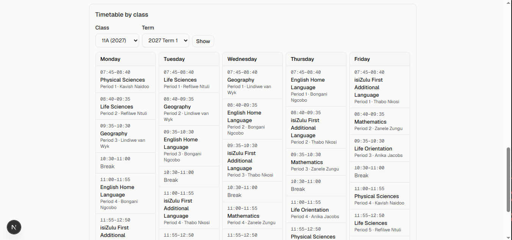
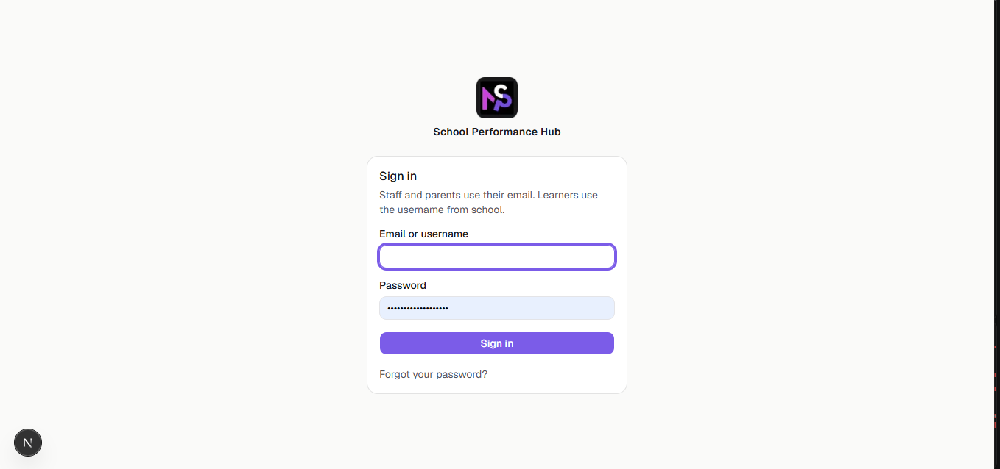
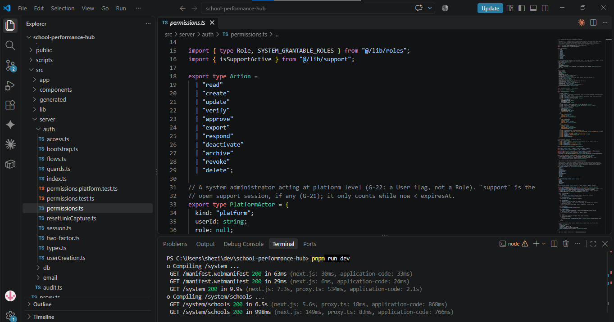
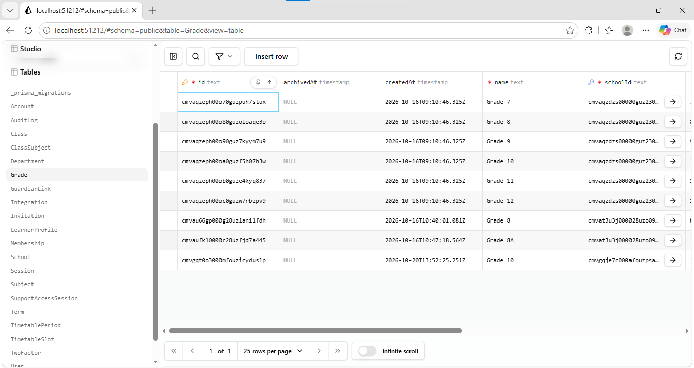
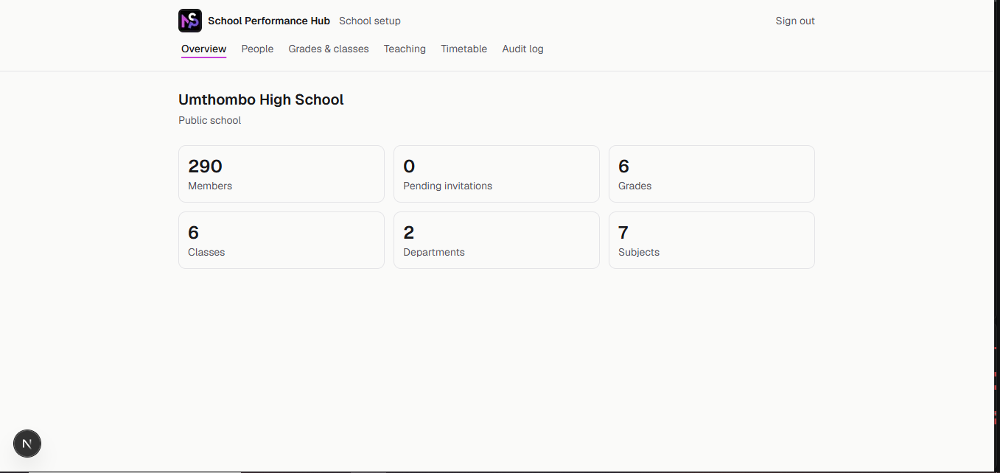
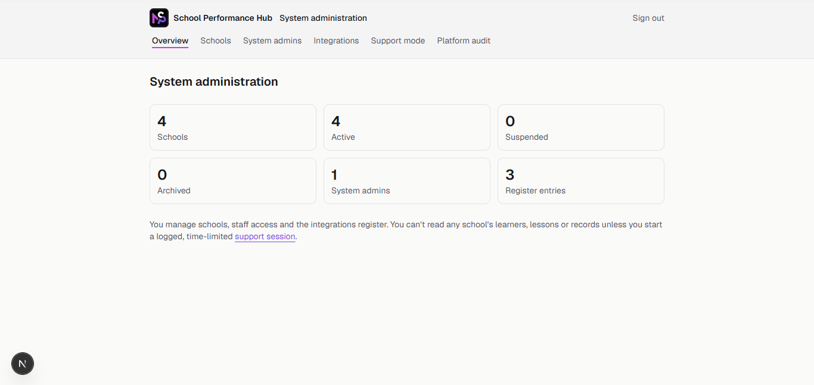

# MSP School Performance Hub – WIL Digital Portfolio
 
**Student:** Minathi Fortune Shezi
**Student Number:** 222353775
**Module:** Project Presentation 3 (PRP370S)
**Assessment:** Assessment 2 – GitHub Portfolio (Industry Placement)
**Host Company:** Mavis Strategic Partners (MSP)
**Mentor / Product Owner:** Sipo Kupiso
 
---
 
## Contents
 
- [Project Overview](#project-overview)
- [My Role](#my-role)
- [Technologies Used](#technologies-used)
- [1. Agile Team Charter](#1-agile-team-charter)
- [2. User Stories and Tasks](#2-user-stories-and-tasks)
- [3. Product Backlog](#3-product-backlog)
- [4. Sprint Backlog](#4-sprint-backlog)
- [5. Agile Logbook](#5-agile-logbook)
- [6. Skills Developed](#6-skills-developed)
- [7. Connect and Conclusion](#7-connect-and-conclusion)
- [References](#references)
---
 
## Project Overview
 
For my Work Integrated Learning (WIL) placement at Mavis Strategic Partners (MSP), I'm the only Full Stack Developer working on the **MSP School Performance Hub**. It's a school management web app, and right now I'm building the first version (the MVP).
 
The idea is simple: help schools keep track of whether teaching is actually happening. Teachers can see their timetable and record whether each lesson took place. Heads of Department can see who is falling behind. School leaders get one place to follow progress across the whole school. Each school's data is kept completely separate, and every change made in the system is recorded.
 
In this portfolio I focus on **Week 3 of the 12-week build plan**, which covers finishing that sprint and planning Week 4. Each section follows the e-portfolio cycle of **Collect, Select, Reflect and Connect**. I show the evidence first, then explain why I picked it and what I learned from it. Section 7 pulls it all together.
 
> **A note on data and hosting:** Because of a decision made under the Protection of Personal Information Act 4 of 2013 (POPIA) (Republic of South Africa, 2013), the project only runs on my machine for now. There is no online repository or Vercel deployment yet. Every screenshot uses **made-up data** for a sample school called *Umthombo High School*, so no real learner information is shown. Anything sensitive to the company has been removed.
 
---
 
## My Role
 
Since I'm the only developer, I handle the whole process myself:
 
- **Building the app:** the database and migrations, the layer that keeps each school's data separate, the permissions for each role, and the screens (designed for phones first).
- **Running Scrum:** I run my own stand-ups, plan each sprint, and hold my own retrospectives.
- **Showing my work:** every Friday since I was given the project, I've presented and demoed my progress at stand-up.
- **Testing:** I write unit tests for the permissions and end-to-end tests for every user role.
- **Raising blockers:** I log problems like the POPIA sign-off and the schema freeze, and escalate them when needed.
---
 
## Technologies Used
 
| Area | Tools |
| :--- | :--- |
| Frontend | Next.js, React, TypeScript |
| Backend & Data | Prisma, PostgreSQL (Docker), Better Auth |
| Testing | Vitest (unit), Playwright (end-to-end) |
| Tooling | pnpm, Git, Prisma Studio |
| Communication | Microsoft Teams |
 
---
 
## 1. Agile Team Charter
 
### Evidence
 
**Why the team exists:** To build a school management app that's ready for a pilot, and that shows how school leaders and teachers can hold each other accountable in one connected system.
 
**Scrum Roles**
 
| Role | Person |
| :--- | :--- |
| Developer & Scrum Master | Minathi Fortune Shezi (me) |
| Product Owner / Stakeholder | Sipo Kupiso (MSP Senior) |
| Key Stakeholder | MSP Information Officer (responsible for POPIA compliance) |
 
**Values and Ground Rules**
 
- **Stay local (POPIA):** Everything runs on my machine (Docker Postgres) until the MSP Information Officer signs off the personal information impact assessment (PIIA). No real learner data leaves my computer.
- **Keep schools separate:** Every table has a `schoolId`, and all data goes through one layer that filters by school. Someone at School A can never see School B's data.
- **Record every change:** Anything that writes to the database is logged in the `AuditLog` table.
**How We Work**
 
- **Sprints:** One week long, Monday to Friday.
- **Daily stand-ups:** I share what I did yesterday, what I'm doing today, and anything blocking me in the MSP team channel.
- **Friday showcase:** Every Friday since I was assigned the project, I've presented and demoed my current work at stand-up. Sipo uses this as the sprint review. Since there's no online repo yet, I demo straight from my machine.
- **Escalation:** Governance blockers go into the project decision log (G-01 to G-28) and get raised with Sipo.
- **Communication:** Mostly Microsoft Teams.
**Definition of Done (DoD)**
 
I only count a task as done when:
 
1. the database migration runs without errors,
2. the permissions have unit tests (Vitest),
3. the screen works properly on a phone, and
4. it passes the Playwright end-to-end tests.
### Reflection
 
The Scrum Guide says the Definition of Done is a shared commitment that makes it clear to everyone what "finished" means (Schwaber and Sutherland, 2020). Even though I work alone, writing mine down helped a lot. Sipo and I could both check my work against the same four points, so it wasn't just me deciding when something was good enough.
 
The Friday showcases mattered more than I expected. Knowing I had to demo something real every week kept me focused on finishing work, not just starting it. It also gave Sipo a regular chance to see progress and give feedback, which was important because he couldn't look at my code online.
 
The charter also had to change along the way. The POPIA sign-off was delayed, so we agreed I'd work locally only. That meant no online testing pipeline, no preview links, and demos on my screen instead of pull requests. I learned that a team charter isn't something you write once and forget. It has to change when the situation changes. Next time, I'd ask for the PIIA to start on the very first day, because it affects how everything gets deployed.
 
---
 
## 2. User Stories and Tasks
 
### Evidence
 
#### US1 – View Weekly Timetable *(Finished in Week 3)* · 5 Story Points
 
> *As a teacher, I want to see my timetable for the week so I can plan my schedule.*
 
**Acceptance Criteria (Given / When / Then)**
 
- *Given* I'm logged in as a teacher, *When* I open the timetable page, *Then* I see my classes for this week.
- *Given* I'm a teacher, *When* I look at the timetable, *Then* I only see classes linked to my `teacherId`.
**Tasks**
 
| Task | Status |
| :--- | :--- |
| Build `/teacher/timetable` page | Done |
| Create `timetable-week.tsx` component | Done |
| Fetch data through `timetableSlot.ts` | Done |
 

*Figure 1: The weekly timetable, designed for phones first (Week 3 work, made-up data).*
 

*Figure 2: The teacher dashboard (made-up data).*
 
#### US2 – Mark Lesson Done *(Planned for Week 4)* · 5 Story Points
 
> *As a teacher, I want to mark a lesson as done in under a minute, or give a reason and a catch-up date, so my progress is recorded accurately.*
 
**Acceptance Criteria**
 
- *Given* a scheduled lesson, *When* I tap "Done", *Then* a `LessonRecord` is saved and logged in the `AuditLog`.
- *Given* a scheduled lesson, *When* I mark it as done, *Then* the whole thing takes less than a minute on a phone.
- *Given* a lesson that didn't happen, *When* I choose a reason, *Then* the record updates and I can set a catch-up date.
**Tasks**
 
| Task | Status |
| :--- | :--- |
| Create `LessonRecord` model | To Do |
| Add permission rules in `permissions.ts` | Done (Week 2) |
| Build the screen for marking lessons | To Do |
 
#### US3 – Track Pacing *(Planned for Week 4)* · 3 Story Points
 
> *As a teacher, I want to compare the topics I've covered with the topics I should have covered, so I know if I'm behind.*
 
**Acceptance Criteria**
 
- *Given* I'm on the pacing page, *When* I've covered fewer topics than planned, *Then* the progress bar turns red.
- *Given* I'm on the pacing page, *When* I'm on track or ahead, *Then* the progress bar shows topics covered against topics expected.
**Tasks**
 
| Task | Status |
| :--- | :--- |
| Create `CurriculumTopic` model | To Do |
| Build the progress bar | To Do |
 

*Figure 3: The `permissions.ts` file, which controls what each role can access (built in Week 2).*
 
### Reflection
 
I chose these three stories because together they make up the curriculum tracker. They also show the whole journey, from a story that's finished (US1) to ones that are still planned (US2 and US3). Writing the acceptance criteria as Given/When/Then made me think about "done" from the teacher's side. Take "under a minute" in US2. Before, it was just a nice idea. Now it's something I can actually test.
 
This evidence also shows a mistake I made. In Week 2 I built the permission rules for US2 and US3 before their database models or screens existed. So for two weeks, that work sat there without giving teachers anything they could see or use. From now on, I'll build each story from the database all the way to the screen in the same sprint. The estimates for these stories go straight into the Product Backlog in Section 3.
 
---
 
## 3. Product Backlog
 
### Evidence
 
**How I prioritise**
 
- **P1:** Must be done for the prototype demo on 13 November.
- **P2:** Clean-up work or things that make other work possible.
- **P3:** Nice to have, but can wait until after the MVP.
Story points use a Fibonacci-style scale (1, 2, 3, 5, 8).
 
| Priority | Backlog Item | Estimate | Status | Sprint | Notes |
| :--- | :--- | :---: | :--- | :--- | :--- |
| P1 | Authentication & Tenant Isolation | 8 | ✅ Done | Week 2 | All 437 tests pass |
| P1 | Timetable & Terms Migration (US1) | 5 | ✅ Done | Week 3 | Includes the screen |
| P1 | Seed Script (Umthombo High) | 2 | ✅ Done | Week 3 | 20 staff, 150 learners (made up) |
| P1 | **CurriculumTopic & LessonRecord Migrations** | 5 | To Do | Week 4 | Has to happen before US2 and US3 |
| P1 | Today's Lessons Screen (US2) | 5 | To Do | Week 4 | Waiting on the LessonRecord migration |
| P1 | Teacher Pacing View (US3) | 3 | To Do | Week 4 | Waiting on the CurriculumTopic migration |
| P1 | POPIA Sign-off (PIIA) | – | ⛔ Blocked | – | Waiting for the MSP Information Officer |
| P2 | Private online repo / preview host | 2 | To Do | Week 4 | Needed before the 13 Nov demo |
| P2 | Next.js 16.4.0 Upgrade | 1 | To Do | Week 4 | Security fix; no risk while local, but must be done before going online |
| P3 | System-admin tooling | 8 | ✅ Done | Unplanned | Scope creep: built outside the sprint goal, moved to "After MVP" |
 
**Kanban Board (start of Week 4)**
 
| To Do | In Progress | Blocked | Done |
| :--- | :--- | :--- | :--- |
| CurriculumTopic & LessonRecord Migrations | | POPIA Sign-off (PIIA) | Authentication & Tenant Isolation |
| Today's Lessons Screen (US2) | | | Timetable & Terms Migration (US1) |
| Teacher Pacing View (US3) | | | Seed Script |
| Private online repo / preview host | | | System-admin tooling (unplanned) |
| Next.js 16.4.0 Upgrade | | | |
 

*Figure 4: Prisma Studio showing the sample data, including the `schoolId` that keeps each school's data separate (made-up data).*
 
### Reflection
 
I picked the Product Backlog because it shows how I deal with things that depend on each other, not just a list of features. US2 and US3 can't start until the `CurriculumTopic` and `LessonRecord` migrations are in place, so those two sit right at the top for Week 4.
 
It also shows the trade-offs I made. I put the Next.js security upgrade at P2 because the app isn't online, so nobody can attack it yet. But I wrote down that it has to be done before we go online, so it doesn't get forgotten. I listed the POPIA sign-off as P1, even though it isn't code, because without it the app can never be shown outside my machine. I was also honest about the system-admin tooling and marked it "Unplanned." That's 8 points of work that didn't help the sprint goal, and I talk about it more in my Logbook.
 
---
 
## 4. Sprint Backlog
 
### Evidence – Week 3 (Mon 19 Oct – Fri 23 Oct)
 
**Sprint Goal:** Have a working timetable that keeps each school's data separate, with a sample school loaded in.
 
| Task | Linked US | Estimate (hrs) | Status |
| :--- | :---: | :---: | :--- |
| Database migration: `timetable_and_learners` | US1 | 3 | ✅ Done |
| Approved one-off migration for the `AuditLog` table | – | 2 | ✅ Done |
| Data layer that filters by `schoolId`, with tests | US1 | 3 | ✅ Done |
| Seed script that can be run again safely (`pnpm db:seed`) | – | 1 | ✅ Done |
| Weekly timetable screen, designed for phones first | US1 | 3 | ✅ Done |
| Playwright test checking what each role can access | – | 2 | ✅ Done |
 
**How it went:** I met the sprint goal and finished all 7 planned story points (US1 and the seed script). I showed the finished timetable at the Friday showcase.
**Extra work:** I also built system-admin tooling (8 points) that wasn't part of the goal. More on that in Section 5.
 
### Reflection
 
The Scrum Guide describes the Sprint Backlog as the developers' own plan, which changes as they learn more during the sprint (Schwaber and Sutherland, 2020). That's exactly what happened in Week 3.
 
My biggest problem was the schema freeze. I needed approval for a one-off migration to add the `AuditLog` table, so every change could be tracked, and I waited two days for it. Instead of doing nothing, I moved things around and wrote the Playwright tests first. I still met the sprint goal. But the system-admin work shows I let myself get pulled away from it, and I should have protected it better. My Logbook in Section 5 shows the blocker day by day, and my retrospective records what I'll do differently.
 
---
 
## 5. Agile Logbook
 
### Evidence
 
**Daily Stand-ups (Week 3)**
 
| Day | Yesterday | Today | Blockers |
| :--- | :--- | :--- | :--- |
| Mon 19 Oct | Finished the tests for keeping schools separate | Draft the `timetable_and_learners` and `AuditLog` migrations | Schema freeze (G-14) |
| Tue 20 Oct | Wrote the migration drafts and sent them for approval | Write the Playwright role tests while I wait | Still waiting for G-14 approval |
| Wed 21 Oct | Wrote the Playwright tests; schema approved late in the day | Run the migrations, build the data layer, start `timetable-week.tsx` | None |
| Thu 22 Oct | Migrations done, data layer and tests finished | Finish the timetable screen and load Umthombo High | None |
| Fri 23 Oct | Screen finished, sample school loaded | Run all end-to-end tests; present and demo the timetable at the Friday showcase with Sipo | None |
 
**Blockers and Decisions** *(from the project decision log, G-01 to G-28)*
 
| ID | What happened | What I did |
| :--- | :--- | :--- |
| G-10 | Everything stays local until the PIIA is signed off, so the online testing pipeline has never run. | Ran Vitest and Playwright on my own machine instead. |
| G-11 | Better Auth problem: forcing a school onto every login broke things for parents with children at two schools. | Moved the school check into the data layer instead of the login session. |
| G-14 | Schema freeze: I needed approval for a one-off migration to add the `AuditLog` table. | Reordered my tasks during the two-day wait. |
| Scope creep | I built system-admin tooling (a Stage 5 feature) before Week 4 work had even started. | Moved it to "After MVP" and got back to the sprint goal. |
 

*Figure 5: The School Admin dashboard, showing only that school's data (made-up data).*
 

*Figure 6: The System Admin dashboard, which was the scope creep item (made-up data).*
 
**Retrospective (Fri 23 Oct)**
 
| What went well | What didn't go well |
| :--- | :--- |
| I built and tested permissions and school separation first, and all 437 tests pass. | I drifted into building Stage 5 system-admin tooling. |
| Moving tasks around kept the sprint going during the schema freeze. | MSP couldn't get a preview link because everything is local. |
| The Friday showcase gave Sipo a clear view of what was done. | |
 
**What I'll change next sprint**
 
| Action | Owner | By when |
| :--- | :--- | :--- |
| Start Week 4 with the `CurriculumTopic` migration | Me | Mon 26 Oct |
| Agree on a private online repo or preview host before the 13 Nov demo | Sipo | Fri 30 Oct |
| Check every new task against the sprint goal before I start it | Me | From Week 4 |
 
### Reflection
 
I chose the Logbook because it's the most honest picture of my placement. What slowed me down most wasn't bugs. It was POPIA, a login design problem, and me taking on work I shouldn't have. Writing it all down each day helped me see things I would have missed. The schema freeze cost me two days, and the system-admin work took 8 story points that did nothing for the sprint goal.
 
Presenting every Friday also kept me honest. If something wasn't finished, it showed straight away in the demo. This taught me that being "done" isn't only about features. It also means respecting security and the rules around data. Next time, I'll check each new task against the sprint goal during stand-up, which is why I added it to my retrospective actions.
 
---
 
## 6. Skills Developed
 
**Technical skills**
 
- Designing a database that keeps multiple schools' data separate (Prisma and PostgreSQL)
- Setting up logins and controlling what each role can see (Better Auth)
- Writing database migrations and seed scripts that can be run more than once
- Building phone-friendly screens with Next.js, React and TypeScript
- Writing unit tests (Vitest) and end-to-end tests (Playwright)
- Logging every change made in the system
**Professional skills**
 
- Running Scrum on my own as a solo developer
- Presenting and demoing my work to my mentor every week
- Writing user stories that can actually be tested
- Deciding what comes first based on what depends on what
- Working within data protection law (POPIA)
- Raising blockers early instead of waiting
- Owning my mistakes, like the scope creep
---
 
## 7. Connect and Conclusion
 
When I look at all five pieces of evidence together, I can see how my understanding of Agile grew during Week 3. The **Team Charter** set the rules and the Definition of Done that everything else is checked against. The **User Stories** split the curriculum tracker into pieces I could test. The **Product Backlog** put those pieces in order based on what depends on what and what's riskiest. The **Sprint Backlog** turned the top of the backlog into a plan for the week. The **Logbook** shows what really happened, including the blockers and scope creep I didn't plan for. My retrospective then fed back into the backlog for the next sprint, and the Friday showcases tied each week together by showing Sipo what was actually finished.
 
The biggest lesson for me is that I built backend logic before the parts users can see, and that delayed real, visible progress. For the rest of my placement, I'll build each story all the way from the database to the screen within one sprint. I'll also keep pushing to get an online repository set up, so I can run proper automated tests and share my progress more easily.
 
Overall, this placement has shown me that real software work depends on people, rules and priorities just as much as code. Building a real product for a real company on my own has made me more disciplined, more careful with people's data, and more honest about how I work.
 
---
