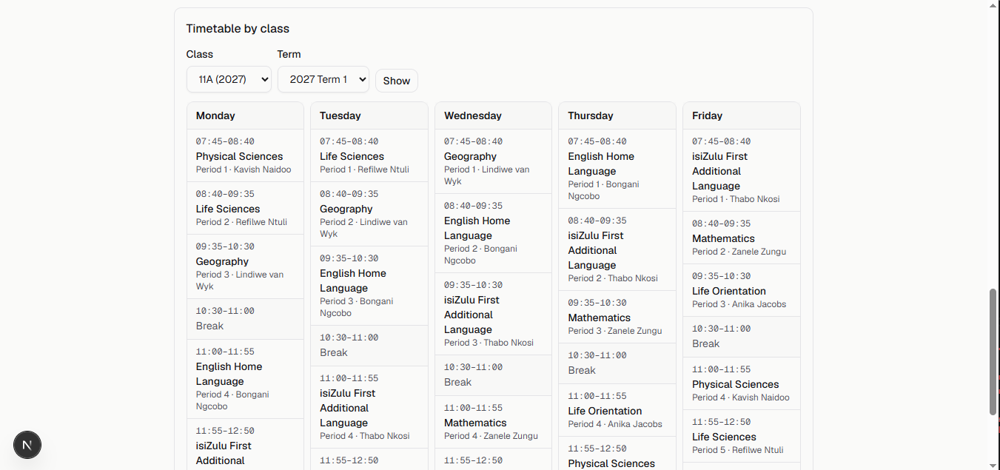
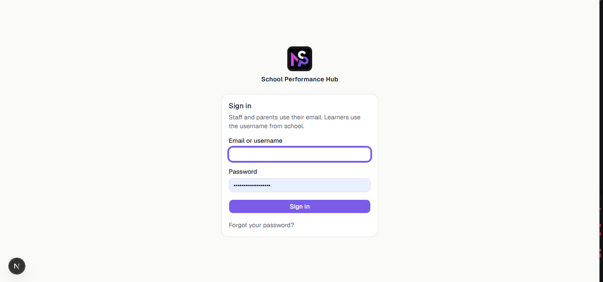
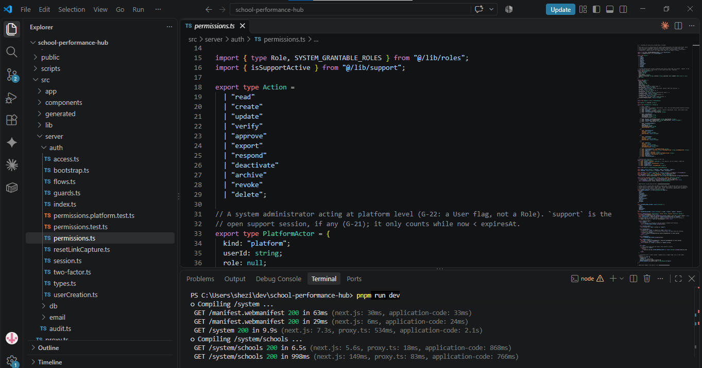
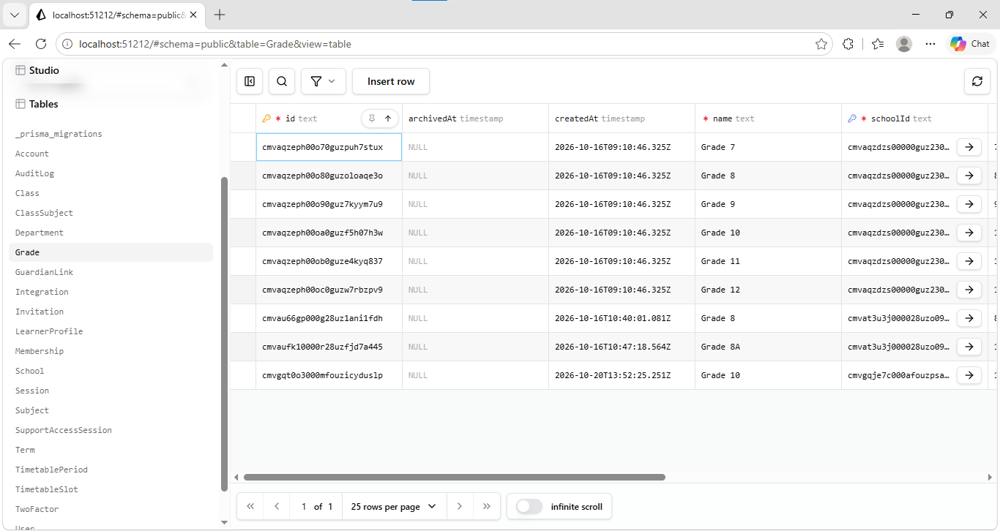
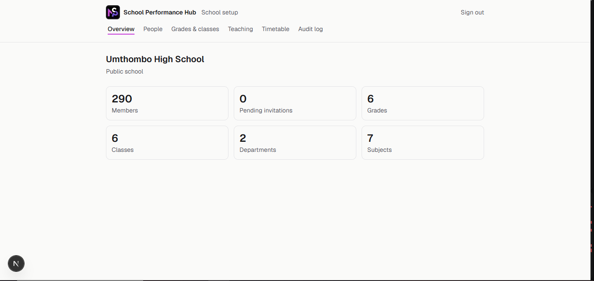
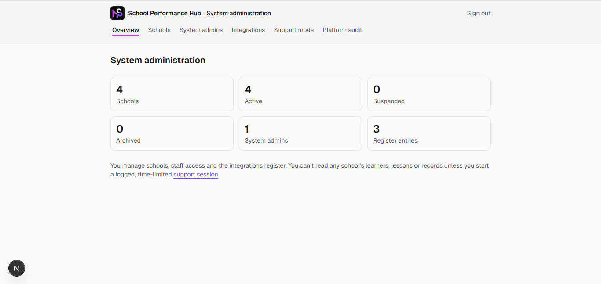

# PRP370 Digital Portfolio

**Student:** Minathi Fortune Shezi
**Student Number:** 222353775
**Module:** Project Presentation 3 (PRP370S)
**Assessment:** Assessment 2 - GitHub Portfolio (Industry Placement)

## Context & Declaration
This portfolio is based on my Work Integrated Learning (WIL) Industry Placement at **Mavis Strategic Partners (MSP)**. During this placement, I am working as the solo Full Stack Developer on the **MSP School Performance Hub** MVP.

For this assessment, I have focused on **Week 3 of the 12-week MVP build plan** (sprint completion and Week 4 planning). Each section follows the e-portfolio cycle of Collect, Select, Reflect and Connect: the evidence shows the artefact, the reflection explains why I selected it and what I learned, and Section 6 connects the artefacts into one summary.

*Note: Because of a governance decision under the Protection of Personal Information Act 4 of 2013 (POPIA) (Republic of South Africa, 2013), the project is currently hosted locally (no remote GitHub or Vercel). All screenshots and database evidence below show fictional seeded data (Umthombo High School), so no real learner data is exposed. Company-sensitive information has been anonymised.*

---

## 1. Agile Team Charter

### Evidence
**Team Purpose:** To build a pilot-ready school management web app that proves a connected accountability loop for school leadership and teachers.

**Scrum Roles:**
*   **Developer & Scrum Master:** Me (Minathi Fortune Shezi)
*   **Product Owner / Stakeholder:** Sipo Kupiso (MSP Senior)
*   **Key Stakeholder:** MSP Information Officer (oversees POPIA compliance)

**Core Values & Boundaries:**
*   **Local-Only Rule (POPIA):** Development is fully local (Docker Postgres) until the MSP Information Officer signs off the personal information impact assessment (PIIA). No real learner data leaves the machine.
*   **Strict Multi-Tenancy:** Every table has a `schoolId`, and all data access goes through a tenant-scoped data layer. A user from School A can never read School B's data.
*   **Audit Trail:** Every write action must be logged to the `AuditLog` table.

**Working Agreements:**
*   **Sprint Length:** 1 week (Monday to Friday).
*   **Stand-ups:** Daily progress updates (yesterday / today / blockers) sent to the MSP team channel.
*   **Review Cadence:** Sipo reviews my work at a weekly Friday sprint review, demonstrated from my machine because there is no remote repository yet.
*   **Escalation:** Governance blockers are logged in the project decision log (G-01 to G-28) and escalated to Sipo.
*   **Communication:** Primary channel is Microsoft Teams.

**Definition of Done (DoD):**
A task is done when the database migration runs cleanly, permissions are unit-tested (Vitest), the UI works on a phone-sized screen, and it passes the end-to-end Playwright tests.

### Reflection
The Scrum Guide describes the Definition of Done as a shared commitment that creates transparency about what "finished" means (Schwaber and Sutherland, 2020). Writing my DoD down gave me that transparency even as a solo developer, because Sipo and I could check work against the same four conditions instead of my own judgement. The charter also had to adapt to a major governance blocker: the POPIA sign-off is delayed. This forced a "local-only" working agreement, which means I cannot use remote CI or share preview links, and it changed how reviews work (screen-shared demos instead of pull requests). This showed me that a charter is a living document that has to change when real-world constraints change. If I did this again, I would push for the PIIA to start on Day 1, because it fundamentally shapes the deployment workflow.

---

## 2. User Stories and Tasks

### Evidence
**US1 — View Weekly Timetable (Completed Week 3) | Estimate: 5 Story Points**
*As a teacher, I want to see my timetable for the week so I can plan my schedule.*
*   **Acceptance Criteria (Given/When/Then):**
    *   *Given* I am a logged-in teacher, *When* I navigate to the timetable page, *Then* I see my scheduled classes for the current week.
    *   *Given* I am a teacher, *When* I view the timetable, *Then* I only see classes assigned to my `teacherId`.
*   **Tasks:** Build `/teacher/timetable` page (Done), create `timetable-week.tsx` (Done), fetch data via `timetableSlot.ts` (Done).

*Figure 1: The mobile-first weekly timetable view (Week 3 deliverable, fictional seeded data).*

*Figure 2: The teacher dashboard interface (fictional seeded data).*

**US2 — Mark Lesson Done (Planned Week 4) | Estimate: 5 Story Points**
*As a teacher, I want to mark a lesson done in under a minute, or give a reason and recovery date, so that pacing is accurate.*
*   **Acceptance Criteria:**
    *   *Given* a scheduled lesson, *When* I tap "Done", *Then* a `LessonRecord` is saved and written to the `AuditLog`.
    *   *Given* a scheduled lesson, *When* I mark it done, *Then* the whole flow takes under one minute on a phone.
    *   *Given* a lesson that did not happen, *When* I select a reason, *Then* the record is updated and a recovery date can be set.
*   **Tasks:** Create `LessonRecord` model (To Do). Add permission rules in `permissions.ts` (Done, Week 2). Build UI marking flow (To Do).

**US3 — Track Pacing (Planned Week 4) | Estimate: 3 Story Points**
*As a teacher, I want to see topics done vs. expected so I know if I am behind.*
*   **Acceptance Criteria:**
    *   *Given* I am on the pacing view, *When* I have completed fewer topics than scheduled, *Then* the progress bar highlights red.
    *   *Given* I am on the pacing view, *When* I am on or ahead of schedule, *Then* the progress bar shows my topics done against topics expected.
*   **Tasks:** Create `CurriculumTopic` model (To Do). Build the progress bar UI (To Do).

*Figure 3: The `permissions.ts` file showing role-based access control implemented in Week 2.*

### Reflection
I selected these three stories because together they make up the curriculum tracker, and they show the full journey from a completed story (US1) to planned stories (US2, US3). Writing acceptance criteria in Given/When/Then form forced me to define "done" from the teacher's point of view. For example, US2's "under one minute" is now a testable condition instead of a vague goal. The artefact also exposes a mistake: I built the permission rules for US2 and US3 in Week 2, ahead of their data models and UI. That created work-in-progress that delivered no user-visible value for two weeks. In future I will slice stories vertically, so each one goes from database to UI in a single sprint. The estimates on these stories feed directly into the Product Backlog in Section 3.

---

## 3. Product Backlog

### Evidence
**Prioritisation Method:** P1 items are critical-path dependencies for the 13 Nov prototype demo. P2 items are technical debt or enablers. P3 items are post-MVP features. Story points use a Fibonacci-style scale (1, 2, 3, 5, 8).

| Priority | Backlog Item | Estimate | Status | Sprint | Notes |
| :--- | :--- | :--- | :--- | :--- | :--- |
| P1 | Authentication & Tenant Isolation | 8 | Done | Week 2 | 437 of 437 tests pass |
| P1 | Timetable & Terms Migration (US1) | 5 | Done | Week 3 | Includes UI component |
| P1 | Seed Script (Umthombo High) | 2 | Done | Week 3 | 20 staff, 150 learners (fictional) |
| P1 | **CurriculumTopic & LessonRecord Migrations** | 5 | **To Do** | Week 4 | Prerequisite for US2 and US3 |
| P1 | Today's Lessons Screen (US2) | 5 | To Do | Week 4 | Depends on LessonRecord migration |
| P1 | Teacher Pacing View (US3) | 3 | To Do | Week 4 | Depends on CurriculumTopic migration |
| P1 | POPIA Sign-off (PIIA) | - | **Blocked** | - | Awaiting MSP Information Officer |
| P2 | Private remote repo / preview host | 2 | To Do | Week 4 | Needed before 13 Nov demo |
| P2 | Next.js 16.4.0 Upgrade | 1 | To Do | Week 4 | Security advisory; no exposure while local-only, must be done before any remote deploy |
| P3 | System-admin tooling | 8 | Done | Unplanned | Scope creep: built outside the sprint goal, logged as "After MVP" |

**Kanban Board (Week 4 start):**

| To Do | In Progress | Blocked | Done |
| :--- | :--- | :--- | :--- |
| CurriculumTopic & LessonRecord Migrations | | POPIA Sign-off (PIIA) | Authentication & Tenant Isolation |
| Today's Lessons Screen (US2) | | | Timetable & Terms Migration (US1) |
| Teacher Pacing View (US3) | | | Seed Script |
| Private remote repo / preview host | | | System-admin tooling (unplanned) |
| Next.js 16.4.0 Upgrade | | | |

<!-- TODO: add a screenshot of the Trello / GitHub Projects board here, e.g.  -->

*Figure 4: Prisma Studio showing the seeded database, including the `schoolId` used for tenant isolation (fictional seeded data).*

### Reflection
I selected the Product Backlog because it shows how I manage prerequisites rather than just features. US2 and US3 cannot start until the `CurriculumTopic` and `LessonRecord` migrations exist, so those migrations sit at the top of Week 4. The backlog also makes trade-offs visible. I ranked the Next.js security upgrade as P2 because the app has no network exposure while it is local-only, but I recorded that it must be done before any remote deployment so it does not become forgotten technical debt. The POPIA sign-off is tracked as a P1 blocker, even though it is not code, because it controls whether the product can ever be demonstrated remotely. Finally, listing the system-admin tooling honestly as "Unplanned" shows 8 points of effort that did not serve the sprint goal, which links directly to the scope creep recorded in my Logbook.

---

## 4. Sprint Backlog (Completed Week 3: Mon 19 Oct – Fri 23 Oct)

### Evidence
**Sprint Goal:** Deliver a fully functional, multi-tenant timetable system with a seeded fictional school.

| Task | Linked US | Estimate (hrs) | Status |
| :--- | :--- | :--- | :--- |
| Database migration: `timetable_and_learners` added | US1 | 3 | Done |
| Approved one-off migration for `AuditLog` table | - | 2 | Done |
| Tenant-scoped data layer: filtered by `schoolId` with tests | US1 | 3 | Done |
| Idempotent seed script (`pnpm db:seed`) | - | 1 | Done |
| UI component: mobile-first weekly timetable | US1 | 3 | Done |
| Playwright E2E test: role-gating per role | - | 2 | Done |

**Sprint result:** Sprint goal met. 7 of 7 planned story points completed (US1 + Seed Script).
**Unplanned work:** System-admin tooling (8 points) was built outside the sprint goal. See the Impediment Log in Section 5.

### Reflection
The Scrum Guide describes the Sprint Backlog as a plan by and for the developers that changes as more is learned during the sprint (Schwaber and Sutherland, 2020). My Week 3 sprint shows this in practice. The biggest challenge was the schema freeze: I needed an approved one-off migration to add the `AuditLog` table so every write could be audited. I was blocked for two days waiting for that approval, so I re-ordered the plan and wrote the Playwright end-to-end tests first instead of sitting idle. I met the sprint goal, but the unplanned system-admin work shows that I did not protect the sprint goal as well as I should have. This artefact connects to my Logbook, where the stand-ups show the blocker day by day and the retrospective records what I will change.

---

## 5. Agile Logbook

### Evidence
**Daily Stand-ups (Week 3):**
*   **Mon 19 Oct:** *Yesterday (Fri):* Finished tenant isolation tests. *Today:* Draft the `timetable_and_learners` and `AuditLog` migrations. *Blockers:* Schema freeze in place (G-14).
*   **Tue 20 Oct:** *Yesterday:* Wrote migration drafts and submitted for approval. *Today:* Write Playwright role-gating tests while waiting. *Blockers:* Still waiting on G-14 approval.
*   **Wed 21 Oct:** *Yesterday:* Wrote Playwright tests; schema approved at end of day. *Today:* Run migrations, build tenant-scoped data layer, start `timetable-week.tsx`. *Blockers:* None.
*   **Thu 22 Oct:** *Yesterday:* Migrations run, data layer and tests done. *Today:* Finish timetable UI and run seed script for Umthombo High. *Blockers:* None.
*   **Fri 23 Oct:** *Yesterday:* UI finished, school seeded. *Today:* Run full E2E suite, sprint review and demo with Sipo. *Blockers:* None.

**Impediment Log (from the project decision log, G-01 to G-28):**
*   **G-10:** Development is fully local until the PIIA is signed off. CI has never run remotely. *Action:* Rely on local Vitest and Playwright runs.
*   **G-11:** Better Auth conflict: making school mandatory on every session broke parent logins (parents with children at two schools). *Action:* Enforced tenancy in the data layer instead of the session.
*   **G-14:** Schema freeze: needed an approved one-off migration to add the `AuditLog` table. *Action:* Re-ordered sprint tasks during the two-day wait.
*   **Scope creep:** System-admin tooling (a Stage 5 item) was built before Week 4 work had started. *Action:* Logged to "After MVP" and refocused on the sprint goal.

*Figure 5: School Admin dashboard showing tenant-scoped access (fictional seeded data).*

*Figure 6: System Admin dashboard, the scope creep item (fictional seeded data).*

**Retrospective (Fri 23 Oct):**
*   **Went well:** Permissions and tenant isolation were built and tested first (437 tests passing). Re-ordering tasks kept the sprint moving during the schema-freeze blocker.
*   **Didn't go well:** Work drifted into Stage 5 system-admin tooling. No shareable preview link for MSP due to local-only hosting.
*   **Improvements:**
    *   Start Week 4 with the `CurriculumTopic` migration (Owner: Me, Target: Mon 26 Oct).
    *   Agree on a private remote repo or preview host with MSP before the 13 Nov demo (Owner: Sipo, Target: Fri 30 Oct).
    *   Check every new task against the sprint goal before starting it (Owner: Me, from Week 4).

### Reflection
I selected the Logbook because it is the most honest record of my WIL experience. My biggest blockers were not coding bugs but POPIA compliance, an authentication design conflict and my own scope creep. Seeing them written down day by day showed me patterns I would not have noticed otherwise: the schema freeze cost two days, and the system-admin work cost 8 story points that did not serve the sprint goal. Tracking these taught me that "done" requires balancing security and governance with feature delivery. If I did this again, I would check each new task against the sprint goal at stand-up, which is why I added that as a retrospective action.

---

## 6. Connect & Conclusion

Reviewing all five artefacts together, I can see how my understanding of Agile developed during Week 3. The **Team Charter** set the rules, values and Definition of Done that every other artefact is measured against. The **User Stories** broke the curriculum tracker into testable pieces, and the **Product Backlog** ordered them by dependency and risk. The **Sprint Backlog** turned the top of that backlog into a weekly plan, and the **Logbook** recorded what actually happened, including the blockers and scope creep that the plan did not predict. The retrospective then fed back into the backlog, closing the loop.

The main lesson across all five artefacts is that I built backend logic ahead of the user-facing work, which delayed visible value. Going forward in my placement, I will focus on **vertical slicing**, so every user story delivers value from the database to the UI within one sprint. I will also prioritise securing a remote repository, so that I can run real CI/CD and share progress with my Product Owner more effectively.

### References
*   Republic of South Africa (2013) *Protection of Personal Information Act 4 of 2013*. Pretoria: Government Printer.
*   Schwaber, K. and Sutherland, J. (2020) *The Scrum Guide: The Definitive Guide to Scrum: The Rules of the Game*. Available at: https://scrumguides.org (Accessed: 27 October 2026).
